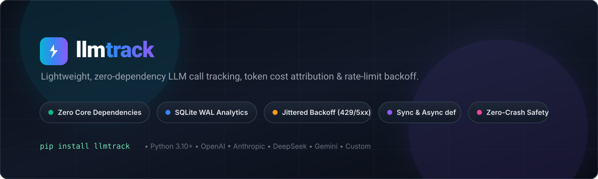
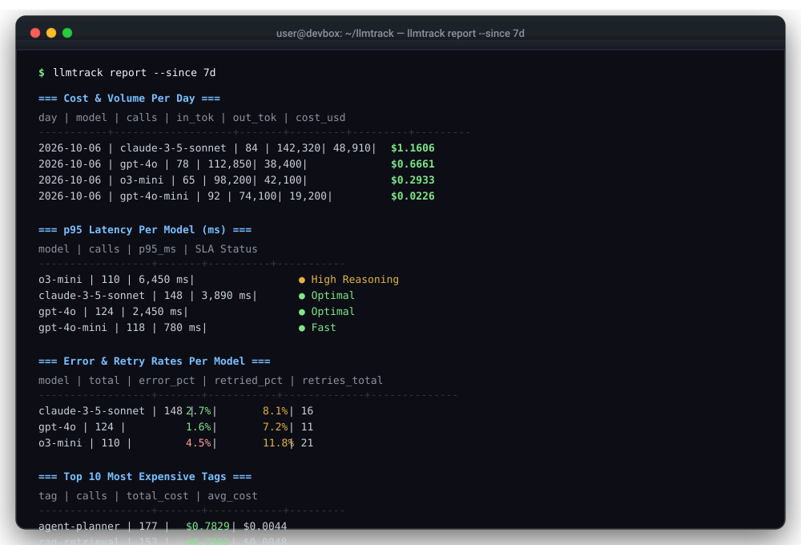
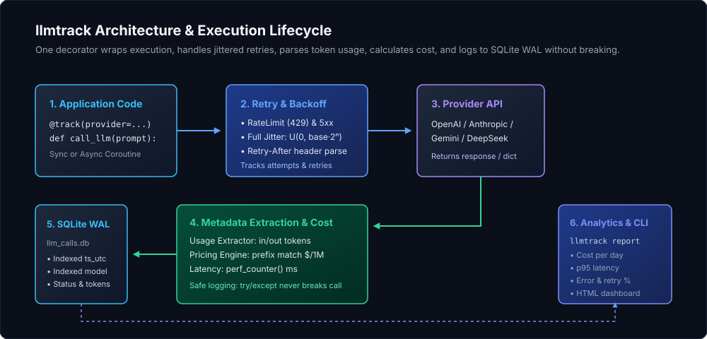

<div align="center">



<p align="center">
  <strong>Zero-dependency LLM call tracking, token cost attribution & rate-limit backoff.</strong>
</p>

<p align="center">
  <a href="https://pypi.org/project/llmtrack"></a>
  <a href="https://sqlite.org/"></a>
  <a href="https://github.com/astral-sh/ruff"></a>
  <a href="LICENSE"></a>
</p>

</div>

---

A small, lightweight library that wraps any LLM API call with a decorator or context manager. It logs **tokens**, **USD cost**, **latency**, **retries**, and **errors** to a local SQLite database with automatic rate-limit backoff, analytics SQL queries, and a CLI report.

- **Zero dependencies**: Pure Python standard library (`sqlite3`, `time`, `functools`, `random`, `contextvars`, `asyncio`).
- **Resilient backoff**: Automatic exponential backoff with full jitter and `Retry-After` header parsing for 429s, 5xx, and timeouts.
- **Fail-safe**: Telemetry failures never interrupt or raise into your LLM caller.
- **Sync, Async & Streaming**: Works with `def`, `async def`, and streaming generators (`stream=True`).
- **Multi-provider**: Built-in extractors for OpenAI, Anthropic, Google Gemini, and DeepSeek, plus generic dict fallback and custom extractors.
- **Micro-overhead**: Adds only **~0.11 ms** per call ([see benchmark report](REPORT.md)).

---

## Quickstart

```bash
pip install llmtrack
```

```python
import openai
from llmtrack import track

client = openai.OpenAI()


@track(provider="openai", tag="summarizer")
def summarize(text: str):
    return client.chat.completions.create(
        model="gpt-4o-mini",
        messages=[{"role": "user", "content": f"Summarize: {text}"}],
    )


summarize("Autonomous agents require clean, local telemetry...")
```

View your metrics:
```bash
llmtrack report
```

<div align="center">
  
</div>

---

## How It Works

<div align="center">
  
</div>

---

## Usage

### Custom Tracker & Async Support
```python
from llmtrack import Tracker

tracker = Tracker(db_path="calls.db")


@tracker.track(provider="anthropic", tag="agent", max_retries=3)
async def ask_claude(prompt: str):
    return await client.messages.create(
        model="claude-3-5-sonnet",
        messages=[{"role": "user", "content": prompt}],
    )
```

### Streaming Responses
Track token usage and total stream duration without altering iteration behavior:
```python
@track(provider="openai", model="gpt-4o", stream=True)
def stream_response(prompt: str):
    return client.chat.completions.create(
        model="gpt-4o",
        messages=[{"role": "user", "content": prompt}],
        stream=True,
    )


for chunk in stream_response("Hello"):
    print(chunk.choices[0].delta.content or "", end="")
```

### Context Manager (`span`)
```python
with tracker.span(provider="openai", model="gpt-4o", tag="eval") as span:
    response = client.chat.completions.create(...)
    span.record(response)
```

### Daily Budget Guard
```python
tracker = Tracker(max_daily_usd=10.00)  # Raises BudgetExceededError before call if limit reached
```

### Pricing Overrides
```python
tracker = Tracker(pricing={"my-custom-model": (1.50, 4.00)})  # $/1M input and output tokens
```

---

## CLI Report

```bash
llmtrack report                           # Formatted terminal tables
llmtrack report --since 7d                # Filter by timeframe (e.g. 24h, 7d, 30d, or ISO date)
llmtrack report --format json             # Export JSON to stdout
llmtrack report --format html --out r.html # Export standalone HTML dashboard
llmtrack report --format csv  --out r.csv  # Export CSV summary
```

---

## Performance & Reliability

Empirical benchmarks measured on SQLite WAL mode:

| Metric | Result | Context |
| :--- | :--- | :--- |
| **Call Overhead** | **0.11 ms** | <0.02% of typical LLM latency |
| **Write Throughput** | **~76,000 rows/sec** (batch) | 16 concurrent threads in WAL mode |
| **Query Speed** | **~38 ms** (7d filter) | 100k indexed rows |
| **Retry Recovery** | **100% recovered** | Injected 20% transient 429 rate-limits |
| **Thundering-Herd Drop**| **46% collision reduction** | Full jitter vs. fixed exponential |

For complete methodology, SQL queries, and coverage metrics, read the [Performance & Reliability Report](REPORT.md).

---

## Design Decisions

- **One row per logical call**: Retries and attempts are tracked on the logical call rather than bloating the DB with partial attempt rows.
- **Full jitter backoff**: Jittered exponential delay (`random(0, min(cap, base * 2^attempt))`) and `Retry-After` header parsing prevent thundering herd retries.
- **NULL cost for unknown models**: `llmtrack` never guesses pricing. Unknown models log `cost_usd = NULL` and warn once so you can provide custom pricing.
- **SQLite WAL mode**: Provides high-concurrency readers and writers without external database infrastructure.

---

## Demo & Testing

Run the included simulation to generate 500 realistic calls (with latency spikes, 429s, and retries) and test the CLI:

```bash
python examples/demo.py
llmtrack report
python -m pytest -v
```

---

## License

Apache 2.0 © [Sparsh Mishra](https://github.com/msparsh)
